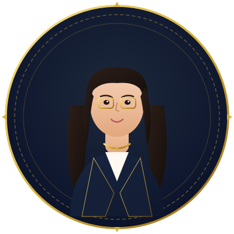

# Sara Amr — Personal Portfolio Website
### Business Informatics & Data Analytics | Université Française d’Égypte

A sleek, responsive, and modern personal portfolio website featuring a sophisticated aesthetic inspired by ancient Egyptian heritage combined with modern minimalism.

---

## 🌟 Visual Identity & Design System

- **Color Palette:**
  - **Primary:** Deep Navy Blue (`#060A14`, `#0A1124`, `#0F1A36`) symbolizing strength, calm authority, and depth.
  - **Accent / Highlights:** Warm Gold & Cream (`#D4AF37`, `#F6E27A`, `#FAF7F0`) symbolizing elegance, balance, and warmth.
  - **Neutrals:** Muted Stone Gray (`#8D99AE`, `#CBD2D9`) inspired by ancient stone representing stability and endurance.
- **Aesthetic / Theme:** Subtle Pharaonic-inspired motifs including custom vector SVGs of the **Eye of Horus (Wedjat)**, the **Ankh (Key of Life)**, and the **Sacred Lotus**, paired with golden corner brackets, subtle hieroglyphic constellation backdrops, and glassmorphism.
- **Typography:**
  - Headings: **Cinzel** (Classic carved Pharaonic serif).
  - Body: **Plus Jakarta Sans** (Ultra-clean, modern geometric sans-serif).

---

## 📂 Project Architecture

```
portfolio web/
├── index.html                   # Complete semantic HTML5 structure with Tailwind CSS & Lucide icons
├── css/
│   └── style.css                # Pharaonic design system, glassmorphism, golden glows, custom scrollbar
├── js/
│   ├── projects-data.js         # Comprehensive case study dataset for all 6 projects
│   └── main.js                  # Modals, filtering, smooth scrolling, email copy, form validation
├── assets/
│   ├── icons/
│   │   ├── ankh.svg             # Pharaonic Ankh emblem (Key of Life)
│   │   ├── eye-of-horus.svg     # Eye of Horus vector (Analytical insight & wisdom)
│   │   ├── lotus.svg            # Sacred Lotus blossom
│   │   └── divider.svg          # Symmetrical golden winged divider
│   └── images/
│       ├── headshot.jpg         # Professional portrait photo
│       ├── headshot.svg         # Pharaonic vector portrait fallback
│       ├── project-skillup.svg  # Skill Up App visual
│       ├── project-fawry.svg    # Fawry Digital Finance Study visual
│       ├── project-suez.svg     # Suez Canal Cities Research visual
│       ├── project-ankhpass.svg # Ankh Pass Tourism App visual
│       ├── project-orgbehavior.svg # Organizational Behavior Study visual
│       └── project-careerlaunch.svg# CareerLaunch Platform visual
└── README.md                    # Project documentation & deployment guide
```

---

## 🚀 How to Open and View the Website

You don't need any complex installation, Node.js, or build commands:

1. **Direct Double-Click**:
   - Simply navigate into this folder (`portfolio web`) and double-click `index.html`.
   - It will open immediately in your default browser (Google Chrome, Microsoft Edge, Safari, Firefox).
2. **Offline-Ready & CDN Powered**:
   - The site uses modern CDN links for fonts and Tailwind utilities, loading in milliseconds.

---

## 📷 How to Add Your Real Photo

1. Place your photo (e.g. `headshot.jpg` or `headshot.png`) into the `assets/images/` folder.
2. Open `index.html` in any text editor.
3. Locate line ~160:
   ```html
   
   ```
4. Change `assets/images/headshot.svg` to `assets/images/headshot.jpg`.
5. Save the file and refresh your browser!

---

## 💼 Included Projects & Case Studies

1. **Skill Up App**: Non-monetary skill-sharing platform concept where users exchange skills instead of money.
2. **Fawry Digital Finance Study**: Research analyzing how Fawry drives financial inclusion via merchant kiosks, FawryPay, and microfinance.
3. **Suez Canal Cities Economic & Cultural Research**: Study focusing on geography, demographics, economy, and climate of Suez.
4. **Ankh Pass (Tourism Mobile App)**: 2-person mobile solution for booking, scheduling, and visitor safety for Egyptian heritage sites.
5. **Organizational Behavior / Local Brand Study**: 5-person study structuring core business departments (Head of Marketing role).
6. **CareerLaunch Web Platform**: 3-person web platform project helping Egyptian students (18-25) transition into industry.

---

## 🌐 Free 1-Minute Hosting & Deployment

### Option A: Netlify Drop (Easiest - 30 seconds)
1. Go to [app.netlify.com/drop](https://app.netlify.com/drop).
2. Drag and drop this entire `portfolio web` folder into the browser box.
3. Your website is instantly live with a free SSL certificate!

### Option B: GitHub Pages
1. Push this folder to a GitHub repository (e.g., `sara-amr-portfolio`).
2. Go to **Settings** > **Pages** > Select `main` branch > Click **Save**.
3. Your site will be live at `https://<your-username>.github.io/<repo-name>/`.

---

## 📬 Contact Information Setup

- **Email**: `saraamrmahmoud@gmail.com`
- **Phone**: `+20 1187563781`
- **University**: Université Française d’Égypte (UFE)
- **References**: Dr. Mariam Gawich (Department Director) & Dr. Osama Hanafy (Professor)

